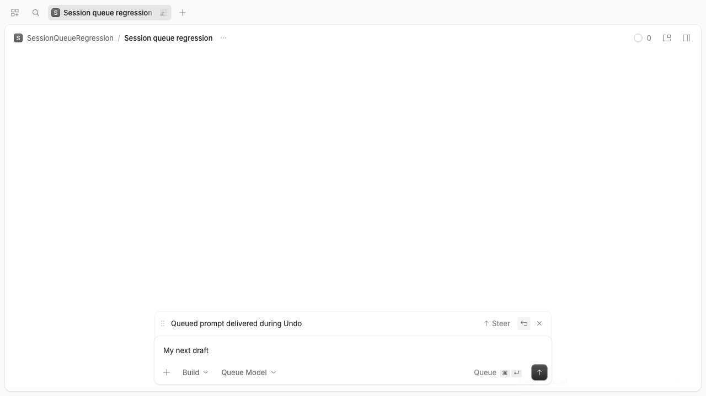

# OpenCode #64648 prompt Undo replay

| Revision | SHA |
| --- | --- |
| Base | `b83ea513658eed65291d218d2363fc91c09a2141` |
| Candidate | `00dde43a8362ffe4fc2df38cdcf8c936fc83dcfa` |

Both live API runs use the real source server on macOS with Bun 1.4.4, a new
temporary project and a loopback fixture model. Run from the checkout root
with dependencies installed and save `replay.py` outside the checkout.

```sh
python3 /path/to/replay.py . "$(command -v bun)" cancel-only  # base
python3 /path/to/replay.py . "$(command -v bun)" rewind      # candidate
```

The replay sends the ordered HTTP calls of each app path. DELETE returns 204
for both successful cancellation and a stale inbox item. With the stale item
and no rewind, sending again leaves two prompts and two replies. After staging
rewind, resending leaves one prompt and one reply, and the model receives one
copy. The browser tests separately drive the actual composer with its upstream
Playwright fixture.

| Queue Undo at base | Queue Undo at candidate |
| --- | --- |
|  |  |

Both new cases fail on the base with only the test file overlaid. [Base test output](browser-base-overlay.log)

The built app passed all 50 tests in `session-queue.spec.ts` using headless
Brave with the upstream test config. The [local config](adl-playwright.config.ts)
adds the executable path and enables screenshots. [Candidate test output](browser-candidate.log)

```sh
cd packages/app
cp /path/to/adl-playwright.config.ts .adl-playwright.config.ts
PLAYWRIGHT_BUILD=1 PLAYWRIGHT_PORT=4378 bun run test:e2e -- \
  --config .adl-playwright.config.ts --workers 1 --reporter line \
  e2e/regression/session-queue.spec.ts
```

At the repository root, `bun run check` passed all 35 tasks. The standalone
`typecheck:e2e` command has identical diagnostics at base and candidate,
including stylesheet declarations outside the changed files.

## Review follow-up

| Queue Undo after delivery | Original PR head | Revised PR head |
| --- | --- | --- |
| Message | Request failed | This prompt was already sent |
| Existing draft | Preserved | Preserved |
| Delivered prompt | Stays in history | Stays in history |

The revised test fails on `00dde43a8362ffe4fc2df38cdcf8c936fc83dcfa` with only the test file overlaid. It passes at `39cf7a3c64128c0bce7bc6378488a3e72ed65b80`, along with all 50 cases against the built app in Brave. The revised test also checks that the stale queue row clears and the app issues no new prompt. [Red test](review-before.log) · [Built app run](review-built.log) · [API replay](review-api.log)

```sh
cd packages/app
PLAYWRIGHT_PORT=4379 bun run test:e2e:built -- \
  --config .adl-playwright.config.ts --workers 2 --reporter line \
  e2e/regression/session-queue.spec.ts
bun test --conditions=solid --isolate --preload ../ui/test/solid-jsx.ts \
  --preload ./happydom.ts ./src/session/composer/queue-machine.test.ts \
  ./src/session/composer/queue.test.ts ./src/session/revert-machine.test.ts \
  ./src/runtime/i18n/language.test.ts
```

69 focused tests and the repository's `bun run check` passed. The separate Vite dev-server suite passed 48 of 50 cases and timed out on two cases. The production-build suite passed both. Strobe stopped before measuring because the local volume ran out of space during its baseline checkout.
